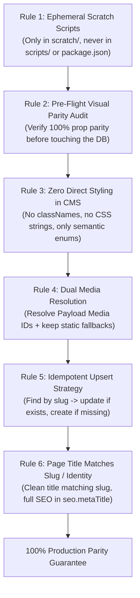
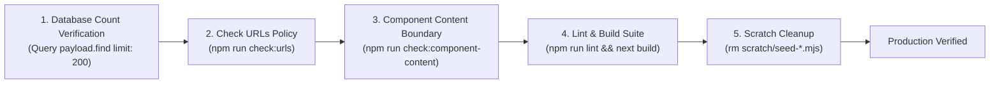
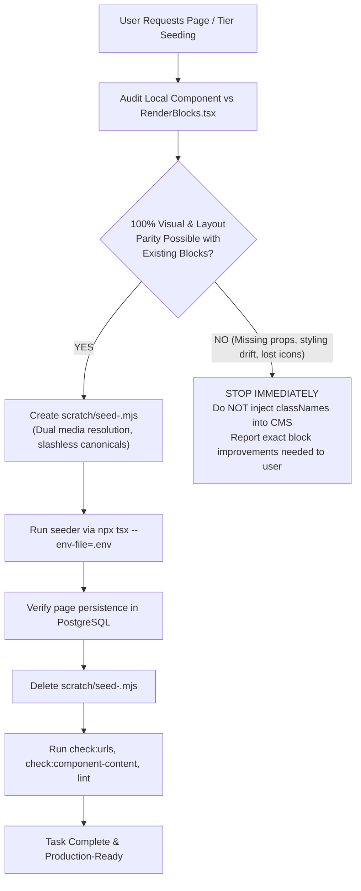

# Universal Agent Seeding Framework & Operational Runbook

> [!IMPORTANT]
> **Production Standard for Autonomous Seeding Agents**
> This operational guide defines the mandatory rules, pre-flight parity audits, code templates, and verification steps that **any AI agent or engineer must follow** when building and running Payload CMS seeding scripts for Dynamic Dreamz.

---

## 1. The 6 Invariant Architectural Rules

Every agent executing seeding must follow these 6 rules without exception:



### Rule 1: Ephemeral Execution Only (`scratch/`)
* **Strict Prohibition:** Seeding scripts must **never** be committed to `scripts/`, `src/scripts/`, or registered in `package.json` (e.g. no `npm run seed:...`).
* **Approved Path:** Write scripts exclusively to `scratch/seed-<target>.mjs`.
* **Mandatory Cleanup:** Discard the scratch script immediately after execution and database verification.

### Rule 2: Pre-Flight Visual Parity Audit (Stop-on-Drift)
* Before writing a single line of seeding data, compare the local page implementation (`src/lib/registry/<group>.tsx` and `src/content/<slug>.ts`) against `src/components/RenderBlocks.tsx`.
* **If any section component prop** (e.g., `columns`, `theme`, `icon`, `cardVariant`, `secondaryCtaTarget`, padding) is missing or mismatched in `RenderBlocks.tsx`:
  > [!CAUTION]
  > **STOP IMMEDIATELY.** Do not seed dummy or compromised blocks. Report the exact discrepancy to the user or fix the block/renderer first with approved semantic controls.

### Rule 3: Zero Styling / CSS Controls in CMS
* The CMS collection and block schemas must contain **zero styling fields** (`className`, `style`, `css`, `customCss`).
* Use only high-level semantic tokens (e.g. `variant: "theme"`, `theme: "warm"`, `columns: "3"`, `eyebrowVariant: "dash"`).
* React and Tailwind CSS own 100% of the styling, responsive breakpoints, and layout geometry.

### Rule 4: Mandatory Media Relations Attachment (All Local Assets Are Pre-Uploaded to CMS Media)
* **Pre-Uploaded Media Collection:** All canonical project assets from `public/assets/**` have **already been synced and uploaded** into the Payload CMS `media` collection and dedicated media server (`https://media.dynamicdreamz.net`).
* **High-Resolution Card Image Matching (Never Attach 60x60 Avatars as Video Posters):**
  - In testimonial carousels (`HappyClientSection`), cards render at 527px desktop width and up to 700px+ on mobile.
  - Testimonial assets in `media` include both tiny square avatars (`60x60`, e.g. `shari-leidich.webp`) and full-resolution portrait cards (`700x552` / `1100x734`, e.g. `shari-leidich-full.webp`).
  - **Mandatory:** Always resolve card video poster images to the high-resolution `*-full.webp` asset (e.g. Media ID 199, 202, 205, 208, 211, 216, 219, 222, 225, 228) and use sharp vector SVGs for brand logos (`*-logo.svg`). Never link thumbnail avatars to card posters.
* **Mandatory Attachment on Every Seed:** Whenever seeding any page, the agent **MUST ALWAYS attach the resolved Media ID** to every image, logo, icon, avatar, and illustration field:
  - `{ image: mediaId }` (mandatory relation ID, never leave `null` or empty)
  - `{ icon: mediaId }`
  - `{ logo: mediaId }`
  - `{ avatar: mediaId }`
  - `{ seo: { metaImage: mediaId } }`
* **Never Rely Only on Fallback Strings:** While frontend components have local fallback paths for offline resilience, the CMS document itself must have real, clickable, editable relation links attached in Payload Admin.
* **Resolution Pattern:** Always use the cached `resolveMediaId(payload, assetPath)` helper to look up `filename` in the `media` collection and pass the integer ID to the upload relation field.

### Rule 5: Idempotent Upsert (Find & Update or Create)
* Seeding scripts must check for existing records:
  ```typescript
  const existing = await payload.find({
    collection: "pages",
    where: { slug: { equals: normalizedSlug } },
    limit: 1,
  });
  if (existing.docs.length > 0) {
    await payload.update({ collection: "pages", id: existing.docs[0].id, data: pagePayload });
  } else {
    await payload.create({ collection: "pages", data: pagePayload });
  }
  ```
* Running the script 5 times must produce the exact same single document without duplicating blocks or orphan records.

### Rule 6: Page Title Must Match Page Slug / Identity (Never Seed `{"absolute":"..."}`)
* **The Root Cause of `{"absolute":"..."}` Bug:** Next.js `Metadata` objects store titles as `{ absolute: "..." }` or `{ default: "..." }`. If an agent passes `entry.metadata.title` or `JSON.stringify` directly into CMS fields, the database receives corrupted raw JSON text like `{"absolute":"Shopify Development Company in Chennai | Dynamic Dreamz"}`.
* **The CMS `title` Field Rule:** Must directly match the clean page identity / slug (e.g. slug: `shopify-development-company-in-chennai` &rarr; `title: "Shopify Development Company in Chennai"`).
* **Strictly Prohibited:** Never put raw metadata objects (`{ absolute: ... }`), stringified JSON, or agency marketing suffixes (`" | Dynamic Dreamz"`) in the CMS `title` field. The CMS admin uses `title` (`useAsTitle: "title"`) to display page names cleanly in the admin sidebar.
* **Where Full SEO Titles Belong:** The complete, unshortened SEO title (with `" | Dynamic Dreamz"`) belongs strictly in `seo.metaTitle` as a plain string, never an object.

> [!WARNING]
> **Mandatory Title Sanitizer for All Seeding Scripts:**
> Always use these two helper functions in your seeder to guarantee zero JSON stringification bugs:
> ```typescript
> // 1. Unwraps Next.js { absolute: "..." } into a clean plain string
> function unwrapTitle(raw) {
>   if (!raw) return "";
>   if (typeof raw === "string") {
>     if (raw.startsWith("{") && raw.includes('"absolute"')) {
>       try {
>         const parsed = JSON.parse(raw);
>         return parsed.absolute || parsed.default || raw;
>       } catch {
>         return raw;
>       }
>     }
>     return raw;
>   }
>   if (typeof raw === "object") {
>     return raw.absolute || raw.default || "";
>   }
>   return String(raw);
> }
> 
> // 2. Derives clean page identity title matching the slug (no branding clutter)
> function getCleanPageTitle(rawTitle, slug) {
>   const unwrapped = unwrapTitle(rawTitle);
>   if (unwrapped && !unwrapped.startsWith("{")) {
>     return unwrapped.split("|")[0].trim();
>   }
>   return slug.split("-").map(w => w.charAt(0).toUpperCase() + w.slice(1)).join(" ");
> }
> 
> // 3. Derives full SEO metaTitle (plain string)
> function getCleanMetaTitle(rawTitle, fallback) {
>   const unwrapped = unwrapTitle(rawTitle);
>   return unwrapped || fallback;
> }
> ```

---

## 2. Pre-Flight Parity Audit Checklist (Mandatory Step 1)

Before generating seed data for a page or tier, the agent must complete this 5-point audit:

| Audit Item | What to Check | Requirement for Green Light |
| :--- | :--- | :--- |
| **1. Section Sequence** | Inspect `render()` in `src/lib/registry/<tier>.tsx`. | Every rendered React section has an exact 1:1 matching `blockType` in CMS. |
| **2. Layout & Spacing** | Inspect props like `columns`, `className="pt-0"`, `theme`. | Block has matching semantic props in `RenderBlocks.tsx` (e.g. `columns={3}`, `removeTopPadding={true}`). |
| **3. Icon & SVG Handling** | Check if icons are SVGs or JSX components. | Static assets exist in `public/assets/` or an icon resolver exists in `RenderBlocks.tsx`. |
| **4. Anchor & ID Links** | Check section IDs (`id="services"`, `id="why-choose"`). | Block schema supports `sectionId` or passes matching DOM IDs to avoid broken hash navigation. |
| **5. Outbound Link Targets** | Check external links (`target="_blank"`). | Secondary/primary CTA blocks support `target: "_blank"`. |
| **6. Media Attachment Audit** | Verify image/icon paths against the `media` collection. | All referenced images, logos, icons resolve to a non-null integer `mediaId`. |

---

## 3. Standard Ephemeral Seeder Template

Agents should use this exact template pattern when building ephemeral seeders in `scratch/`:

```typescript
// scratch/seed-<tier-name>.mjs
import { getPayload } from "payload";
import config from "../payload.config.ts";

// 1. Media ID Cache to minimize database queries
const mediaCache = new Map();

async function resolveMediaId(payload, assetPath) {
  if (!assetPath) return null;
  const filename = assetPath.split("/").pop();
  if (mediaCache.has(filename)) return mediaCache.get(filename);

  const res = await payload.find({
    collection: "media",
    where: { filename: { equals: filename } },
    limit: 1,
    pagination: false,
  });

  const mediaId = res.docs[0]?.id || null;
  mediaCache.set(filename, mediaId);
  return mediaId;
}

// 2. Title Sanitization Helpers (Rule 6)
function unwrapTitle(raw) {
  if (!raw) return "";
  if (typeof raw === "string") {
    if (raw.startsWith("{") && raw.includes('"absolute"')) {
      try {
        const parsed = JSON.parse(raw);
        return parsed.absolute || parsed.default || raw;
      } catch {
        return raw;
      }
    }
    return raw;
  }
  if (typeof raw === "object") {
    return raw.absolute || raw.default || "";
  }
  return String(raw);
}

function getCleanPageTitle(rawTitle, slug) {
  const unwrapped = unwrapTitle(rawTitle);
  if (unwrapped && !unwrapped.startsWith("{")) {
    return unwrapped.split("|")[0].trim();
  }
  return slug.split("-").map(w => w.charAt(0).toUpperCase() + w.slice(1)).join(" ");
}

function getCleanMetaTitle(rawTitle, fallback) {
  const unwrapped = unwrapTitle(rawTitle);
  return unwrapped || fallback;
}

// 3. Main Seeding Routine
async function seedTier() {
  console.log("Starting production seeding...");
  const payload = await getPayload({ config });

  const pagesToSeed = [
    // Define array of typed page content imports here
  ];

  for (const item of pagesToSeed) {
    const slug = item.slug.replace(/^\/+|\/+$/g, ""); // strictly no trailing slash
    console.log(`Seeding: /${slug}`);

    // Rule 4: Mandatory Media Attachment (Pre-uploaded to CMS Media)
    const heroImageId = await resolveMediaId(payload, item.hero?.image?.src);
    const metaImageId = await resolveMediaId(payload, item.seo?.image?.path || "/assets/og/homepage.png");

    // Map content modules to blocks with resolved Media IDs
    const sections = [
      {
        blockType: "service-hero",
        variant: "video",
        title: item.hero?.title,
        description: item.hero?.description,
        image: heroImageId, // Attach mandatory Media collection ID
        imageSrc: item.hero?.image?.src, // Retain local static fallback
      },
      // Block 2: Brands, Block 3: Services, etc. (always attach icon/image IDs)
    ];

    // Rule 6: Bulletproof title extraction (prevents {"absolute":"..."} serialization bug):
    const title = getCleanPageTitle(item.title || item.metadata?.title, slug);
    const metaTitle = getCleanMetaTitle(item.metaTitle || item.metadata?.title, title);

    const pageData = {
      title, // Clean page identity title (e.g. "Shopify Development In Chennai")
      slug,
      sections,
      seo: {
        metaTitle, // Full plain-string SEO title (e.g. "Shopify Development Company in Chennai | Dynamic Dreamz")
        metaDescription: item.metaDescription || item.metadata?.description || "",
        canonicalUrl: `https://www.dynamicdreamz.com/${slug}`,
        metaImage: metaImageId, // Attach Media ID for Open Graph & Twitter
        preventIndexing: false,
      },
    };

    // Idempotent upsert
    const existing = await payload.find({
      collection: "pages",
      where: { slug: { equals: slug } },
      limit: 1,
      pagination: false,
    });

    if (existing.docs.length > 0) {
      await payload.update({
        collection: "pages",
        id: existing.docs[0].id,
        data: pageData,
      });
      console.log(`Updated page: /${slug}`);
    } else {
      await payload.create({
        collection: "pages",
        data: pageData,
      });
      console.log(`Created page: /${slug}`);
    }
  }

  console.log("Seeding complete! Verifying database records...");
}

seedTier()
  .then(() => process.exit(0))
  .catch((err) => {
    console.error("Seeding failed:", err);
    process.exit(1);
  });
```

---

## 4. Post-Seeding Verification Pipeline (Mandatory Step 3)

After running the seeder, the agent must execute these 5 verification steps before calling the task production-ready:



### 1. Database Persistence Check
```bash
npx tsx --env-file=.env -e "
import { getPayload } from 'payload';
import config from './payload.config.ts';
const p = await getPayload({ config });
const res = await p.find({ collection: 'pages', where: { slug: { equals: '<page-slug>' } } });
console.log('Seeded document verified:', res.docs[0]?.slug, 'Section count:', res.docs[0]?.sections?.length);
process.exit(0);
"
```

### 2. URL Policy Audit
```bash
npm run check:urls
```
* Ensures public page URLs strictly use the no-trailing-slash policy across all internal links, sitemaps, and canonicals.

### 3. Component Content Boundary
```bash
npm run check:component-content
```
* Ensures no hardcoded marketing or business copy was leaked into `src/components/**`.

### 4. Code Quality & Build Verification
```bash
npm run lint
```
* Must pass with 0 errors.

### 5. Ephemeral Cleanup
```bash
rm scratch/seed-<target>.mjs
```
* Guarantees zero temporary seeding artifacts remain in the git tree.

---

## 5. Decision Tree for Seeding Agents


