# Master Blocks Implementation Plan: Service Pages in Payload CMS

> [!IMPORTANT]
> **Universal Service Page CMS Architecture**
> By consolidating 50+ fragmented one-off sections into **10 modular Master Blocks with configurable variants**, any service page, city page, theme page, migration page, or the homepage can be assembled with **100% visual parity** to the live site, zero database bloat, and complete drag-and-drop flexibility in Payload CMS.

---

## 1. Architectural Overview & Block Inventory

Dynamic Dreamz has **49+ service and marketing pages**. Analysis of all sections across the entire codebase reveals that every service page follows a clean, structured component hierarchy.

Instead of creating unique CMS blocks for every minor page variant, we utilize **10 Master Blocks** where each block supports specific visual layouts via a typed `variant` field.

```mermaid
flowchart TD
    subgraph ServicePageBuilder["Universal Service Page Structure"]
        B1["1. Master Hero Block (service-hero)"]
        B2["2. Brand Partners & Clients (brand-partners)"]
        B3["3. Services & Capabilities (services-grid)"]
        B4["4. Portfolio & Work Showcase (portfolio-showcase)"]
        B5["5. Why Choose & Proof Stats (proof-stats)"]
        B6["6. Process & Roadmap Timeline (process-timeline)"]
        B7["7. Pricing & Engagement Plans (pricing-table)"]
        B8["8. Testimonials & Client Reviews (testimonials-carousel)"]
        B9["9. FAQ Accordion (faq-accordion)"]
        B10["10. Final CTA Conversion Banner (cta-banner)"]
    end

    B1 --> B2 --> B3 --> B4 --> B5 --> B6 --> B7 --> B8 --> B9 --> B10
```



---

## 2. Summary Table of the 10 Master Blocks

| # | Block Name | CMS Slug | Status | Visual Variants / Modes | Target React Components |
|---|---|---|---|---|---|
| **1** | **Master Hero** | `service-hero` | **COMPLETED** | `video`, `tablet-slider`, `image`, `reviews`, `centered`, `text-only`, `home` | `ServiceHeroVideoSection`, `ServiceHeroSection`, `CityPageHeroSection`, `SplitImageHeroSection`, `HomeHeroSection` |
| **2** | **Brand Partners / Clients** | `brand-partners` | Ready to build | `slider` (marquee), `grid`, `density-compact`, `density-wide` | `IndustryBrandsSection`, `BrandPartnersSection`, `IntegrationsSection` |
| **3** | **Services & Capabilities** | `services-grid` | Ready to build | `cards-grid` (3/4 cols), `stage-tabs` (Build/Grow/Migrate), `accordion-list` | `ShopifyStageServicesSection`, `ThemeCustomizationServicesSection`, `AgencyServicesSection`, `ShopifyMigrationServicesSection` |
| **4** | **Portfolio & Work Showcase** | `portfolio-showcase` | Ready to build | `2-col`, `3-col`, `4-col`, `split-header`, `marquee` | `PortfolioShowcaseSection`, `SelectedWorkSection`, `ServicesCaseStudiesSection` |
| **5** | **Why Choose & Proof Stats** | `proof-stats` | Ready to build | `counter-bar` (4 metrics), `comparison-grid`, `team-boxes`, `why-cards` | `EvaluationFrameworkSection`, `ShopifyTeamBoxesSection`, `WhyChooseShopifyMigrationSection`, `ShopifyPlusProofSection` |
| **6** | **Process & Roadmap** | `process-timeline` | Ready to build | `numbered-grid` (01-05), `horizontal-stepper`, `vertical-milestones` | `OurDevelopmentProcessSection`, `ShopifyMigrationNumberedGridSection`, `ShopifyHorizontalProcessSection`, `NumberedProcessTimelineSection` |
| **7** | **Pricing & Engagement Plans** | `pricing-table` | Ready to build | `tiered-cards` (Starter/Growth/Enterprise), `hourly-bundles`, `custom-quote` | `PricingTableSection`, `BuyShopifyDevelopmentHoursSection` |
| **8** | **Testimonials & Client Stories** | `testimonials-carousel` | Ready to build | `carousel-quotes`, `client-stories-grid`, `video-proof` | `HappyClientSection`, `TestimonialsSection` |
| **9** | **FAQ Accordion** | `faq-accordion` | Ready to build | `split-2col` (sticky left header, right accordions), `centered-accordion` | `SplitFaqSection`, `HomeFaqSection` |
| **10** | **Final CTA Banner** | `cta-banner` | Ready to build | `split-cta` (dual button), `minimal-strip`, `image-blend` | `CtaBannerSection`, `ImageCtaSection`, `WhiteLabelFinalCtaSection` |

---

## 3. Standard 7-Step Workflow for Each Master Block

Whenever creating a new Master Block, follow this exact step-by-step checklist to ensure zero runtime breakage, proper database syncing, and strict visual parity:

1. **Schema Definition (`src/payload/blocks/<BlockName>.ts`)**:
   - Define typed fields matching the existing React section component props.
   - Use Payload upload relations for images/logos (`{ type: "upload", relationTo: "media" }`).
   - Define fallback static text fields (`src`, `alt`, `width`, `height`) for resilience.
   - Assign concise `dbName` to array fields (e.g. `bp_items`, `sg_cards`) to keep Postgres identifiers within 63 characters.

2. **Collection Registration (`src/payload/collections/Pages.ts`)**:
   - Import and add the block configuration to the `sections.blocks` array in `Pages.ts`.

3. **Database Schema Sync (PostgreSQL / Neon)**:
   - Check if database tables or enums already exist.
   - Run the non-conflicting DDL statements (e.g., `CREATE TABLE IF NOT EXISTS`, `ALTER TYPE ... ADD VALUE IF NOT EXISTS`) ephemerally.
   - Never let Drizzle run unhandled interactive CLI prompts in headless environments.

4. **TypeScript Type Generation**:
   - Run `npx payload generate:types` to ensure `src/types/payload-types.ts` is 100% synchronized.

5. **Dispatcher Integration (`src/components/RenderBlocks.tsx`)**:
   - Add the block dispatcher case `case "<slug>":`.
   - Implement dual asset resolution (`resolveMediaUrl(item.logo) || item.src || fallback`).
   - Map variant settings to the matching established React section component.

6. **Ephemeral Seeding & Verification**:
   - Test by seeding or editing the block on the test page (`/test-page`) in Payload Admin.
   - Verify server-rendered HTML at `http://localhost:3000/test-page` for 100% visual and interactive parity.
   - Clean up any temporary scratch scripts immediately.

7. **Quality Gates Verification**:
   - Run `npm run check:urls`
   - Run `npm run check:component-content`
   - Run `npm run lint`

---

## 4. Master Blocks Detailed Specification

### Block 1: Master Hero Block (`service-hero`) — [STATUS: COMPLETED]
- **File**: `src/payload/blocks/ServiceHeroBlock.ts`
- **Component**: `RenderBlocks.tsx` -> `ServiceHeroVideoSection`, `ServiceHeroSection`, `CityPageHeroSection`, `SplitImageHeroSection`, `HomeHeroSection`
- **Variants Supported**:
  1. `video`: Split layout with looping background MP4 video and overlay badge.
  2. `tablet-slider`: Split layout with interactive vertical tablet mockup slider and badges.
  3. `image`: Split layout with featured hero image (supports normal and bottom alignment).
  4. `reviews`: Split layout with animated Clutch/Trustpilot review cards.
  5. `centered`: Centered headline with co-branding logos (e.g. Appmaker x DD).
  6. `text-only`: Full-width typographic header with metric badges.
  7. `home`: Centered homepage hero with gradient background and 4 horizontal proof badges.

---

### Block 2: Brand Partners & Clients (`brand-partners`) — [STATUS: READY TO BUILD]
- **Target File**: `src/payload/blocks/BrandPartnersBlock.ts`
- **Target Components**: `IndustryBrandsSection`, `BrandPartnersSection`, `IntegrationsSection`
- **Key Fields**:
  - `heading`: Text (e.g. "Trusted by Leading Brands")
  - `description`: Textarea
  - `variant`: Select (`slider` | `grid` | `compact`)
  - `density`: Select (`standard` | `flexible` | `dense`)
  - `brands`: Array (`bp_items`) of `{ name: text, logo: upload(media), src: text, alt: text, width: number, height: number, href: text }`

---

### Block 3: Services & Capabilities (`services-grid`) — [STATUS: READY TO BUILD]
- **Target File**: `src/payload/blocks/ServicesGridBlock.ts`
- **Target Components**: `ShopifyStageServicesSection`, `ThemeCustomizationServicesSection`, `AgencyServicesSection`, `ShopifyMigrationServicesSection`
- **Key Fields**:
  - `eyebrow`: Text
  - `title`: Text (H2)
  - `description`: Textarea
  - `variant`: Select (`cards-grid` | `stage-tabs` | `accordion-list`)
  - `stages`: Array (`sg_stages`) for tabbed navigation (e.g. "Build", "Grow", "Migrate", "Support")
  - `services`: Array (`sg_items`) of `{ title, description, bullets, icon: upload(media), src, href, ctaText }`

---

### Block 4: Portfolio & Work Showcase (`portfolio-showcase`) — [STATUS: READY TO BUILD]
- **Target File**: `src/payload/blocks/PortfolioShowcaseBlock.ts`
- **Target Components**: `PortfolioShowcaseSection`, `SelectedWorkSection`, `ServicesCaseStudiesSection`
- **Key Fields**:
  - `eyebrow`: Text
  - `title`: Text
  - `description`: Textarea
  - `columns`: Select (`2` | `3` | `4`)
  - `headerLayout`: Select (`centered` | `split`)
  - `platformMark`: Upload (Media relation for Shopify Plus badge)
  - `items`: Array (`ps_items`) of `{ title, client, industry, description, image: upload(media), src, tags: array, href, metrics: text }`

---

### Block 5: Why Choose & Proof Stats (`proof-stats`) — [STATUS: READY TO BUILD]
- **Target File**: `src/payload/blocks/ProofStatsBlock.ts`
- **Target Components**: `EvaluationFrameworkSection`, `ShopifyTeamBoxesSection`, `WhyChooseShopifyMigrationSection`, `ShopifyPlusProofSection`
- **Key Fields**:
  - `eyebrow`: Text
  - `title`: Text
  - `description`: Textarea
  - `variant`: Select (`counters-bar` | `evaluation-cards` | `team-boxes` | `comparison-grid`)
  - `counters`: Array (`ps_counters`) of `{ value: text, label: text, note: text, tone: select }`
  - `boxes`: Array (`ps_boxes`) of `{ title, description, icon: upload(media), src, badgeText }`

---

### Block 6: Process & Roadmap Timeline (`process-timeline`) — [STATUS: READY TO BUILD]
- **Target File**: `src/payload/blocks/ProcessTimelineBlock.ts`
- **Target Components**: `OurDevelopmentProcessSection`, `ShopifyMigrationNumberedGridSection`, `ShopifyHorizontalProcessSection`, `NumberedProcessTimelineSection`
- **Key Fields**:
  - `eyebrow`: Text
  - `heading`: Text
  - `description`: Textarea
  - `variant`: Select (`numbered-cards` | `horizontal-stepper` | `vertical-milestones`)
  - `steps`: Array (`pt_steps`) of `{ stepNumber: text, title: text, description: text, bullets: array, duration: text }`

---

### Block 7: Pricing & Engagement Plans (`pricing-table`) — [STATUS: READY TO BUILD]
- **Target File**: `src/payload/blocks/PricingTableBlock.ts`
- **Target Components**: `PricingTableSection`, `BuyShopifyDevelopmentHoursSection`
- **Key Fields**:
  - `eyebrow`: Text
  - `heading`: Text
  - `description`: Textarea
  - `variant`: Select (`tiers` | `hourly-bundles`)
  - `plans`: Array (`pt_plans`) of `{ name, price, period, badge, description, features: array, isFeatured: boolean, ctaLabel, ctaHref }`

---

### Block 8: Testimonials & Client Stories (`testimonials-carousel`) — [STATUS: READY TO BUILD]
- **Target File**: `src/payload/blocks/TestimonialsCarouselBlock.ts`
- **Target Components**: `HappyClientSection`, `TestimonialsSection`
- **Key Fields**:
  - `eyebrow`: Text
  - `heading`: Text
  - `description`: Textarea
  - `variant`: Select (`client-stories` | `quotes-slider` | `grid`)
  - `items`: Array (`tc_items`) of `{ clientName, clientRole, company, quote, rating, logo: upload(media), avatar: upload(media), platform: select }`

---

### Block 9: FAQ Accordion (`faq-accordion`) — [STATUS: READY TO BUILD]
- **Target File**: `src/payload/blocks/FaqAccordionBlock.ts`
- **Target Components**: `SplitFaqSection`, `HomeFaqSection`
- **Key Fields**:
  - `eyebrow`: Text
  - `heading`: Text
  - `description`: Textarea
  - `idPrefix`: Text (for ARIA accessibility attributes)
  - `faqs`: Array (`fa_items`) of `{ question: text, answer: textarea }`

---

### Block 10: Final CTA Banner (`cta-banner`) — [STATUS: READY TO BUILD]
- **Target File**: `src/payload/blocks/CtaBannerBlock.ts`
- **Target Components**: `CtaBannerSection`, `ImageCtaSection`, `WhiteLabelFinalCtaSection`
- **Key Fields**:
  - `heading`: Text
  - `subheading`: Text
  - `variant`: Select (`default-cream` | `dark-ink` | `split-image`)
  - `primaryCta`: Group `{ label: text, href: text }`
  - `secondaryCta`: Group `{ label: text, href: text }`
  - `image`: Upload (Media relation)

---

## 5. Execution Roadmap

```text
[✓] Step 1: Master Hero Block (service-hero) -> Completed & verified on /test-page
[ ] Step 2: Brand Partners Block (brand-partners)
[ ] Step 3: FAQ Accordion Block (faq-accordion)
[ ] Step 4: Final CTA Banner Block (cta-banner)
[ ] Step 5: Testimonials Block (testimonials-carousel)
[ ] Step 6: Services Grid Block (services-grid)
[ ] Step 7: Portfolio Showcase Block (portfolio-showcase)
[ ] Step 8: Why Choose & Proof Stats Block (proof-stats)
[ ] Step 9: Process Timeline Block (process-timeline)
[ ] Step 10: Pricing Table Block (pricing-table)
```

Each block will be built iteratively following the 7-step checklist, with immediate visual and lint verification.
