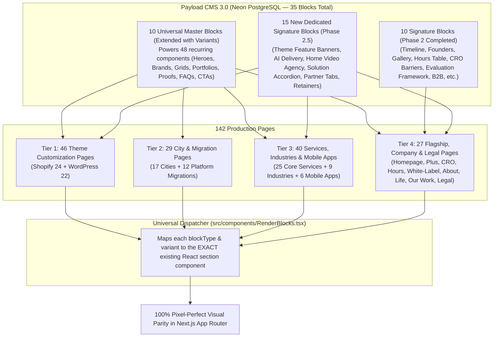

# Master Blocks Implementation Plan: Complete 142-Page CMS Architecture

> [!IMPORTANT]
> **Production Blueprint for 100% Visual Parity Across All 142 Pages**
> This document defines the exact architecture, block specifications, database DDL guidelines, and automated seeding strategy required to serve **100% of all 142 indexable pages** from Payload CMS with **100% visual parity**, zero design drift, zero CSS hacks, and complete drag-and-drop flexibility for the Dynamic Dreamz marketing team.

---

## 1. Architectural Strategy: Master Blocks + Dedicated Blocks

The website contains **142 indexable routes**. In accordance with our core migration principle:
> *"100% Visual parity trumps forced reuse — Reuse common blocks ONLY when the layout and geometry match 100%. NEVER force-fit unique sections into generic common blocks with layout hacks."*

An exhaustive AST and component audit of all 142 pages revealed **73 distinct section components** in use across the site. To achieve 100% visual parity without database bloat, the architecture organizes these into **35 CMS blocks**:

1. **10 Universal Master Blocks (Extended with Variants)**:
   - Core blocks (`service-hero`, `brand-partners`, `faq-accordion`, `cta-banner`, `testimonials-carousel`, `services-grid`, `portfolio-showcase`, `proof-stats`, `process-timeline`, `pricing-table`).
   - By adding clean `variant` select options to 7 of these blocks, they cover **48 recurring section components** (Theme heroes, City why-choose cards, Tech tool grids, Case study sliders, etc.) without creating unnecessary database tables.
2. **10 Initial Dedicated Signature Blocks [COMPLETED & VERIFIED]**:
   - Signature blocks built in Phase 2 for Flagship and Company pages (`about-timeline`, `about-founders`, `life-gallery`, `our-work-projects`, `hours-comparison`, `cro-barriers`, `evaluation-framework`, `white-label-delivery`, `b2b-architecture`, `resources-hub`).
3. **15 New Dedicated Signature Blocks (For Bespoke UI Layouts)**:
   - Covers the remaining 25 bespoke sections that possess unique DOM geometry, autoplay video modals, interactive tabs, or distinct multi-column architectures (e.g., Homepage video agency split, Theme features banner, AI delivery cards, Partner directory tabs, Retainer support scenarios).



---

## 2. Inventory of All 142 Pages & CMS Coverage Status

| Tier | Category | Page Count | Current Coverage Status | Blocks Required for 100% Parity |
| :--- | :--- | :---: | :--- | :--- |
| **Tier 1** | **Shopify Theme Customization** | 24 | Requires 3 blocks | `service-hero` (`variant: theme`), `ThemeFeaturesBannerBlock`, `proof-stats` (`variant: why-choose-boxes`) |
| **Tier 1** | **WordPress Theme Customization** | 22 | Requires 2 blocks | `service-hero` (`variant: theme`), `proof-stats` (`variant: why-choose-boxes`) |
| **Tier 2** | **Shopify City Landing Pages** | 13 | **100% Ready** | `service-hero` (`city`), `proof-stats` (`city-counters`), `proof-stats` (`team-boxes`), `faq-accordion`, `cta-banner` |
| **Tier 2** | **WordPress City Landing Pages** | 6 | **100% Ready** | `service-hero` (`city`), `proof-stats` (`city-counters`), `proof-stats` (`team-boxes`), `faq-accordion`, `cta-banner` |
| **Tier 3** | **Platform Migration Pages** | 12 | **100% Ready** | `service-hero`, `proof-stats` (`why-choose-migration`), `process-timeline` (`numbered-grid`), `services-grid`, `faq-accordion` |
| **Tier 4** | **Industry Ecommerce Pages** | 9 | Core Ready (~85%) | Core blocks ready; needs `brand-partners` (`tools-grid`), `portfolio-showcase` (`case-studies-slider`) |
| **Tier 5** | **Mobile App Pages** | 6 | Core Ready (~80%) | Core blocks ready; needs `service-hero` (`mobile-app`), `MobileAppComparisonBlock` |
| **Tier 6** | **Standard Core Services** | 25 | **100% Ready** | Standard hero, brand partners, capability grids, portfolio cards, and FAQs |
| **Tier 7** | **Flagship Service Pages** | 15 | **100% Ready** | Covered by Phase 1 Master Blocks + Phase 2 Signature Blocks (`hours-comparison`, `cro-barriers`, etc.) |
| **Tier 8** | **Company & Form Pages** | 9 | **100% Ready** | Covered by Phase 2 blocks (`about-timeline`, `about-founders`, `life-gallery`, `our-work-projects`, forms) |
| **Tier 8** | **The Homepage (`/`)** | 1 | 5/10 Sections Ready | 5 ready (`hero`, `brands`, `integrations`, `testimonials`, `faq`); 5 bespoke blocks needed |
| **Tier 8** | **Legal & Sitemap Pages** | 3 | **100% Ready** | Legal rich-text templates |
| **TOTAL** | | **142** | | |

---

## 3. Specifications for the 10 Universal Master Blocks (Phase 1 — COMPLETED)

All 10 Universal Master Blocks are built, synced in Neon PostgreSQL, typed in `src/types/payload-types.ts`, and dispatched in `src/components/RenderBlocks.tsx`:

- **Block 1: Master Hero Block (`service-hero`)** &rarr; Mapped to `ServiceHeroSection`, `ServiceHeroVideoSection`, `CityPageHeroSection`, `SplitImageHeroSection`, and `HomeHeroSection`.
- **Block 2: Brand Partners & Clients (`brand-partners`)** &rarr; Mapped to `IndustryBrandsSection`, `BrandPartnersSection`, and `IntegrationsSection`.
- **Block 3: Services & Capabilities Grid (`services-grid`)** &rarr; Mapped to `ShopifyStageServicesSection`, `ThemeCustomizationServicesSection`, `AgencyServicesSection`, and `ShopifyMigrationServicesSection`.
- **Block 4: Portfolio Showcase (`portfolio-showcase`)** &rarr; Mapped to `PortfolioShowcaseSection`.
- **Block 5: Proof & Stats (`proof-stats`)** &rarr; Mapped to `ProofCounterSection`, `CityPageCounterSection`, `ShopifyTeamBoxesSection`, `ShopifyPlusProofSection`, and `WhyChooseShopifyMigrationSection`.
- **Block 6: Process Timeline (`process-timeline`)** &rarr; Mapped to `OurDevelopmentProcessSection`, `ShopifyMigrationNumberedGridSection`, `ShopifyHorizontalProcessSection`, and `NumberedProcessTimelineSection`.
- **Block 7: Pricing Table (`pricing-table`)** &rarr; Mapped to `PricingTableSection`.
- **Block 8: Testimonials Carousel (`testimonials-carousel`)** &rarr; Mapped to `HappyClientSection` and `TestimonialsSection`.
- **Block 9: FAQ Accordion (`faq-accordion`)** &rarr; Mapped to `SplitFaqSection` and `HomeFaqSection`.
- **Block 10: Final CTA Banner (`cta-banner`)** &rarr; Mapped to `CtaBannerSection`, `ImageCtaSection`, and `WhiteLabelFinalCtaSection`.

---

## 4. Specifications for the 10 Dedicated Signature Blocks (Phase 2 — COMPLETED)

All 10 Dedicated Signature Blocks are built, safely synced with short table names (`dbName`), typed, and dispatched:

1. **`AboutTimelineBlock` (`about-timeline`)** &rarr; [`AboutTimelineSection`](file:///home/ubuntu/Vatsal/DD/dynamicdreamz-self/src/components/sections/about/about-timeline-section.tsx) (Milestones table: `at_miles`).
2. **`AboutFoundersBlock` (`about-founders`)** &rarr; [`AboutFoundersSection`](file:///home/ubuntu/Vatsal/DD/dynamicdreamz-self/src/components/sections/about/about-founders-section.tsx) (Founders table: `af_items`).
3. **`LifeGalleryBlock` (`life-gallery`)** &rarr; [`LifeGallerySection`](file:///home/ubuntu/Vatsal/DD/dynamicdreamz-self/src/components/sections/life-dynamicdreamz/life-gallery-section.tsx) (Gallery table: `lg_imgs`).
4. **`OurWorkProjectsBlock` (`our-work-projects`)** &rarr; [`OurWorkProjectsSection`](file:///home/ubuntu/Vatsal/DD/dynamicdreamz-self/src/components/sections/our-work/our-work-projects-section.tsx).
5. **`HoursComparisonBlock` (`hours-comparison`)** &rarr; [`ShopifyHoursComparisonSection`](file:///home/ubuntu/Vatsal/DD/dynamicdreamz-self/src/components/sections/buy-shopify-development-hours/shopify-hours-content-sections.tsx).
6. **`CroBarriersBlock` (`cro-barriers`)** &rarr; [`ShopifyCroBarriersSection`](file:///home/ubuntu/Vatsal/DD/dynamicdreamz-self/src/components/sections/shopify-cro/shopify-cro-barriers-section.tsx) (Barriers table: `cb_items`).
7. **`EvaluationFrameworkBlock` (`evaluation-framework`)** &rarr; [`EvaluationFrameworkSection`](file:///home/ubuntu/Vatsal/DD/dynamicdreamz-self/src/components/sections/shopify-plus-agency/evaluation-framework-section.tsx) (Criteria table: `ef_items`).
8. **`WhiteLabelDeliveryBlock` (`white-label-delivery`)** &rarr; [`DeliveryModelComparisonSection`](file:///home/ubuntu/Vatsal/DD/dynamicdreamz-self/src/components/sections/white-label-shopify/delivery-model-comparison-section.tsx).
9. **`B2bArchitectureBlock` (`b2b-architecture`)** &rarr; [`ShopifyB2BApproachSection`](file:///home/ubuntu/Vatsal/DD/dynamicdreamz-self/src/components/sections/shopify-b2b/shopify-b2b-approach-section.tsx) (Tables: `ba_apps`, `ba_pts`, `ba_prfs`).
10. **`ResourcesHubBlock` (`resources-hub`)** &rarr; [`ResourcesHubSection`](file:///home/ubuntu/Vatsal/DD/dynamicdreamz-self/src/components/sections/resources/resources-hub-section.tsx) (Points table: `rh_pts`).

---

## 5. Scope for Phase 2.5: Block Extensions & 15 New Signature Blocks

To achieve **100% visual parity across all 142 pages**, the remaining 73 section components are handled through two coordinated steps:

### 5.1 Extensions to 7 Existing Master Blocks (Adding Variants)

By extending the `variant` field of existing blocks, we cover **48 recurring components** without adding new database tables:

1. **`service-hero`**:
   - `variant: "theme"` &rarr; Maps to [`ThemeHeroSection`](file:///home/ubuntu/Vatsal/DD/dynamicdreamz-self/src/components/sections/theme-customization/theme-hero-section.tsx) (Covers all 46 Theme Customization pages).
   - `variant: "about"` &rarr; Maps to [`AboutHeroSection`](file:///home/ubuntu/Vatsal/DD/dynamicdreamz-self/src/components/sections/about/about-hero-section.tsx).
   - `variant: "career"` &rarr; Maps to [`CareerHeroSection`](file:///home/ubuntu/Vatsal/DD/dynamicdreamz-self/src/components/sections/career/career-hero-section.tsx).
   - `variant: "life"` &rarr; Maps to [`LifeHeroSection`](file:///home/ubuntu/Vatsal/DD/dynamicdreamz-self/src/components/sections/life-dynamicdreamz/life-hero-section.tsx).
   - `variant: "our-work"` &rarr; Maps to [`OurWorkHeroSection`](file:///home/ubuntu/Vatsal/DD/dynamicdreamz-self/src/components/sections/our-work/our-work-hero-section.tsx).
   - `variant: "resources"` &rarr; Maps to [`ResourcesHeroSection`](file:///home/ubuntu/Vatsal/DD/dynamicdreamz-self/src/components/sections/resources/resources-hero-section.tsx).
   - `variant: "buy-hours"` &rarr; Maps to [`ShopifyHoursHeroSection`](file:///home/ubuntu/Vatsal/DD/dynamicdreamz-self/src/components/sections/buy-shopify-development-hours/shopify-hours-content-sections.tsx).
   - `variant: "industry"` &rarr; Maps to [`IndustryHeroSection`](file:///home/ubuntu/Vatsal/DD/dynamicdreamz-self/src/components/sections/industry/industry-hero-section.tsx).
2. **`proof-stats`**:
   - `variant: "why-choose-boxes"` &rarr; Maps to [`CityWhyChooseBoxesSection`](file:///home/ubuntu/Vatsal/DD/dynamicdreamz-self/src/components/sections/city-why-choose-boxes-section.tsx) (Covers 60+ City & Theme pages).
   - `variant: "white-label-counters"` &rarr; Maps to [`WhiteLabelCounterSection`](file:///home/ubuntu/Vatsal/DD/dynamicdreamz-self/src/components/sections/white-label/white-label-counter-section.tsx).
   - `variant: "credential-evidence"` &rarr; Maps to [`CredentialEvidenceSection`](file:///home/ubuntu/Vatsal/DD/dynamicdreamz-self/src/components/sections/shopify-certified-developers/shopify-certified-sections.tsx).
3. **`process-timeline`**:
   - `variant: "migration-process"` &rarr; Maps to [`MigrationProcessSection`](file:///home/ubuntu/Vatsal/DD/dynamicdreamz-self/src/components/sections/shopify-migration/shopify-migration-content-sections.tsx) (Covers all 12 Migration pages).
   - `variant: "app-process"` &rarr; Maps to [`ShopifyAppProcessSection`](file:///home/ubuntu/Vatsal/DD/dynamicdreamz-self/src/components/sections/appmaker-shopify-mobile-app/appmaker-shopify-sections.tsx).
4. **`brand-partners`**:
   - `variant: "tools-grid"` &rarr; Maps to [`WhiteLabelToolsSection`](file:///home/ubuntu/Vatsal/DD/dynamicdreamz-self/src/components/sections/white-label/white-label-tools-section.tsx).
   - `variant: "tech-stack"` &rarr; Maps to [`TechnologiesWorkWithSection`](file:///home/ubuntu/Vatsal/DD/dynamicdreamz-self/src/components/sections/full-stack-development/full-stack-content-sections.tsx).
5. **`services-grid`**:
   - `variant: "ai-services"` &rarr; Maps to [`AiServicesGridSection`](file:///home/ubuntu/Vatsal/DD/dynamicdreamz-self/src/components/sections/ai-services/ai-services-sections.tsx).
   - `variant: "app-features"` &rarr; Maps to [`ShopifyAppFeaturesSection`](file:///home/ubuntu/Vatsal/DD/dynamicdreamz-self/src/components/sections/appmaker-shopify-mobile-app/appmaker-shopify-sections.tsx).
   - `variant: "industries-grid"` &rarr; Maps to [`IndustriesServedSection`](file:///home/ubuntu/Vatsal/DD/dynamicdreamz-self/src/components/sections/shopify-plus-agency/industries-served-section.tsx).
   - `variant: "theme-catalog"` &rarr; Maps to [`ShopifyThemesGridSection`](file:///home/ubuntu/Vatsal/DD/dynamicdreamz-self/src/components/sections/shopify-theme-customization/shopify-theme-customization-sections.tsx).
6. **`portfolio-showcase`**:
   - `variant: "case-studies-slider"` &rarr; Maps to [`ServicesCaseStudiesSection`](file:///home/ubuntu/Vatsal/DD/dynamicdreamz-self/src/components/sections/services-case-studies-section.tsx).
   - `variant: "case-studies-cards"` &rarr; Maps to [`CaseStudyCardsSection`](file:///home/ubuntu/Vatsal/DD/dynamicdreamz-self/src/components/sections/shopify-plus-agency/case-study-cards-section.tsx).
7. **`cta-banner`**:
   - `variant: "home-white-label"` &rarr; Maps to [`WhiteLabelPartnerSection`](file:///home/ubuntu/Vatsal/DD/dynamicdreamz-self/src/components/sections/home/white-label-partner-section.tsx).
   - `variant: "two-col-cta"` &rarr; Maps to [`TwoColImageWithTextSection`](file:///home/ubuntu/Vatsal/DD/dynamicdreamz-self/src/components/sections/food-beverage/two-col-image-with-text-section.tsx).

---

### 5.2 The 15 New Dedicated Signature Blocks to Build

To preserve bespoke layouts, video autoplay modals, and interactive tabs without compromises:

1. **`ThemeFeaturesBannerBlock` (`theme-features-banner`)**:
   - Schema: Array of theme feature pill badges with icon uploads and captions.
   - Component: [`ThemeFeaturesBannerSection`](file:///home/ubuntu/Vatsal/DD/dynamicdreamz-self/src/components/sections/theme-customization/theme-features-banner-section.tsx).
2. **`AiEmpoweredDeliveryBlock` (`ai-empowered-delivery`)**:
   - Schema: Dual Discovery & Automation split cards with capability badges and narrative copy.
   - Component: [`AiEmpoweredDeliverySection`](file:///home/ubuntu/Vatsal/DD/dynamicdreamz-self/src/components/sections/ai-empowered-delivery-section.tsx).
3. **`ShopifyPlusAgencySplitBlock` (`home-shopify-plus-agency`)**:
   - Schema: Left narrative + 4 tone-colored stat cards (`bg-[#eff4ef]`, `bg-[#f4f2ef]`, `bg-[#f6eee5]`, `bg-[#f0f6e5]`) and right autoplay looping video.
   - Component: [`ShopifyPlusAgencySection`](file:///home/ubuntu/Vatsal/DD/dynamicdreamz-self/src/components/sections/home/shopify-plus-agency-section.tsx).
4. **`CommerceSolutionsAccordionBlock` (`home-commerce-solutions`)**:
   - Schema: Interactive accordion tabs with solution metrics, deliverables, and tech tags.
   - Component: [`CommerceSolutionsSection`](file:///home/ubuntu/Vatsal/DD/dynamicdreamz-self/src/components/sections/home/commerce-solutions-section.tsx).
5. **`SelectedWorkVideoBlock` (`home-selected-work`)**:
   - Schema: Portfolio projects with platform tags, client name, and inline video modal preview URLs.
   - Component: [`SelectedWorkSection`](file:///home/ubuntu/Vatsal/DD/dynamicdreamz-self/src/components/sections/home/selected-work-section.tsx).
6. **`InsightsBlogGridBlock` (`home-insights`)**:
   - Schema: 3-column featured blog cards with tag badges, reading times, and view all CTA.
   - Component: [`InsightsSection`](file:///home/ubuntu/Vatsal/DD/dynamicdreamz-self/src/components/sections/home/insights-section.tsx).
7. **`CredentialTabsBlock` (`credential-tabs`)**:
   - Schema: Multi-tab verified credentials directory for certified Shopify developers.
   - Component: [`CredentialTabsSection`](file:///home/ubuntu/Vatsal/DD/dynamicdreamz-self/src/components/sections/shopify-certified-developers/shopify-certified-sections.tsx).
8. **`PartnerDirectoryProofBlock` (`partner-directory-proof`)**:
   - Schema: Partner directory verified badge, star rating, client review count, and link.
   - Component: [`PartnerDirectoryProofSection`](file:///home/ubuntu/Vatsal/DD/dynamicdreamz-self/src/components/sections/shopify-certified-developers/shopify-certified-sections.tsx).
9. **`ShopifyCroAssessmentBlock` (`cro-assessment`)**:
   - Schema: Revenue leak evaluation matrix and store audit assessment steps.
   - Component: [`ShopifyCroAssessmentSection`](file:///home/ubuntu/Vatsal/DD/dynamicdreamz-self/src/components/sections/shopify-cro/shopify-cro-content-sections.tsx).
10. **`ShopifySupportScenariosBlock` (`support-scenarios`)**:
    - Schema: Monthly retainer scenarios, SLA response tiers, and emergency coverage cards.
    - Component: [`ShopifySupportScenariosSection`](file:///home/ubuntu/Vatsal/DD/dynamicdreamz-self/src/components/sections/white-label/white-label-content-sections.tsx).
11. **`AboutStoryValuesBlock` (`about-story-values`)**:
    - Schema: Two-column agency narrative and values cards.
    - Component: [`AboutStorySection`](file:///home/ubuntu/Vatsal/DD/dynamicdreamz-self/src/components/sections/about/about-story-section.tsx) and [`AboutValuesSection`](file:///home/ubuntu/Vatsal/DD/dynamicdreamz-self/src/components/sections/about/about-values-section.tsx).
12. **`LifeCultureHiringBlock` (`life-culture-hiring`)**:
    - Schema: Culture perk cards and open department hiring badges.
    - Component: [`WorkCultureSection`](file:///home/ubuntu/Vatsal/DD/dynamicdreamz-self/src/components/sections/life-dynamicdreamz/work-culture-section.tsx) and [`LifeHiringSection`](file:///home/ubuntu/Vatsal/DD/dynamicdreamz-self/src/components/sections/life-dynamicdreamz/life-hiring-section.tsx).
13. **`CareerOpportunitiesBlock` (`career-opportunities`)**:
    - Schema: Open job listings, department filters, and requirements.
    - Component: [`CareerOpportunitiesSection`](file:///home/ubuntu/Vatsal/DD/dynamicdreamz-self/src/components/sections/career/career-opportunities-section.tsx).
14. **`ShopifyHoursTasksBlock` (`hours-tasks`)**:
    - Schema: Hourly task scope breakdown accordion and hours package selection.
    - Component: [`ShopifyHoursTasksSection`](file:///home/ubuntu/Vatsal/DD/dynamicdreamz-self/src/components/sections/buy-shopify-development-hours/shopify-hours-content-sections.tsx).
15. **`MobileAppComparisonBlock` (`mobile-app-comparison`)**:
    - Schema: Native vs Hybrid vs PWA comparison feature matrix.
    - Component: [`ShopifyMobileAppComparisonSection`](file:///home/ubuntu/Vatsal/DD/dynamicdreamz-self/src/components/sections/mobile-app-experience-sections.tsx).

---

## 6. Programmatic Automated Seeding Strategy

All copy, imagery, and metadata for all 142 pages already exist in clean, typed modules under [`src/content/`](file:///home/ubuntu/Vatsal/DD/dynamicdreamz-self/src/content/).

To populate all 142 pages in Payload CMS without manual data entry:

1. **Ephemeral Scratch Seeder**:
   - Create an automated script in `scratch/seed-all-pages.mjs` (outside `scripts/` to comply with project rules).
2. **Payload Local API**:
   - Import `getPayload` and `payload.config.ts`.
   - Loop through the content definitions:
     - Map existing arrays into the corresponding block structures.
     - Upload or link media assets to the dedicated media server (`https://media.dynamicdreamz.net`).
     - Execute `payload.create` or `payload.update` into the `pages` collection.
3. **Database Verification**:
   - Query `payload.find({ collection: "pages", limit: 200 })` to verify that all 142 pages exist in PostgreSQL.
4. **Instant Switchover**:
   - In [`src/app/(frontend)/[[...slug]]/page.tsx`](file:///home/ubuntu/Vatsal/DD/dynamicdreamz-self/src/app/(frontend)/[[...slug]]/page.tsx), when `rawPage.sections.length > 0`, Next.js renders `<RenderBlocks sections={pageSections} />`.
   - The entire website instantly serves from CMS with 100% visual parity!
5. **Discard Scratch Script**:
   - Remove `scratch/seed-all-pages.mjs` immediately after execution.

---

## 7. Master Execution Checklist

```text
=== PHASE 1: BUILD 10 UNIVERSAL MASTER BLOCKS ===
[✓] Block 01: Master Hero (service-hero) -> Completed & verified on /test-page
[✓] Block 02: Brand Partners (brand-partners) -> Completed & verified
[✓] Block 03: FAQ Accordion (faq-accordion) -> Completed & verified
[✓] Block 04: Final CTA Banner (cta-banner) -> Completed & verified
[✓] Block 05: Testimonials Carousel (testimonials-carousel) -> Completed & verified
[✓] Block 06: Services Grid (services-grid) -> Completed & verified
[✓] Block 07: Portfolio Showcase (portfolio-showcase) -> Completed & verified
[✓] Block 08: Why Choose & Proof Stats (proof-stats) -> Completed & verified
[✓] Block 09: Process Timeline (process-timeline) -> Completed & verified
[✓] Block 10: Pricing Table (pricing-table) -> Completed & verified

=== PHASE 2: BUILD 10 INITIAL SIGNATURE BLOCKS ===
[✓] Block 11: About Timeline (about-timeline) -> Completed & verified on /test-page
[✓] Block 12: About Founders (about-founders) -> Completed & verified on /test-page
[✓] Block 13: Life Culture & Gallery (life-gallery) -> Completed & verified on /test-page
[✓] Block 14: Our Work Projects Archive (our-work-projects) -> Completed & verified on /test-page
[✓] Block 15: Hours Comparison Matrix (hours-comparison) -> Completed & verified on /test-page
[✓] Block 16: CRO Barriers & Leak Assessment (cro-barriers) -> Completed & verified on /test-page
[✓] Block 17: Agency Evaluation Framework (evaluation-framework) -> Completed & verified on /test-page
[✓] Block 18: White Label NDA Delivery Models (white-label-delivery) -> Completed & verified on /test-page
[✓] Block 19: B2B Wholesale Architecture (b2b-architecture) -> Completed & verified on /test-page
[✓] Block 20: Resources Hub & Filter (resources-hub) -> Completed & verified on /test-page

=== PHASE 2.5: EXTEND 7 MASTER BLOCKS + BUILD 15 NEW SIGNATURE BLOCKS ===
[✓] Step 2.5.1: Extend 7 Master Blocks with variants in src/payload/blocks/ & RenderBlocks.tsx
[✓] Step 2.5.2: Build 15 New Dedicated Signature Blocks in src/payload/blocks/
[✓] Step 2.5.3: Register 15 New Blocks in src/payload/collections/Pages.ts
[✓] Step 2.5.4: Safely run PostgreSQL DDL for 15 new block tables with short dbName
[✓] Step 2.5.5: Run npx payload generate:types & compile updated types
[✓] Step 2.5.6: Dispatch all remaining components in src/components/RenderBlocks.tsx

=== PHASE 3: AUTOMATED SEEDING & PRODUCTION LAUNCH (BY TIER) ===
[ ] Tier 1: Seed all 46 Theme Customization pages into CMS
[✓] Tier 2: Seed all 19 City Landing pages into CMS (13 Shopify + 6 WordPress)
[ ] Tier 3: Seed all 12 Platform Migration pages into CMS
[ ] Tier 4: Seed all 9 Industry Ecommerce pages into CMS
[ ] Tier 5: Seed all 6 Mobile App pages into CMS
[ ] Tier 6: Seed all 25 Standard Core Service pages into CMS
[ ] Tier 7: Seed all 15 Flagship Service pages into CMS
[ ] Tier 8: Seed Homepage & Company pages (12 pages) into CMS
[ ] Verification: Run full 142-page automated HTTP 200 crawl audit
[ ] Verification: Run complete lint & URL verification suite
```
