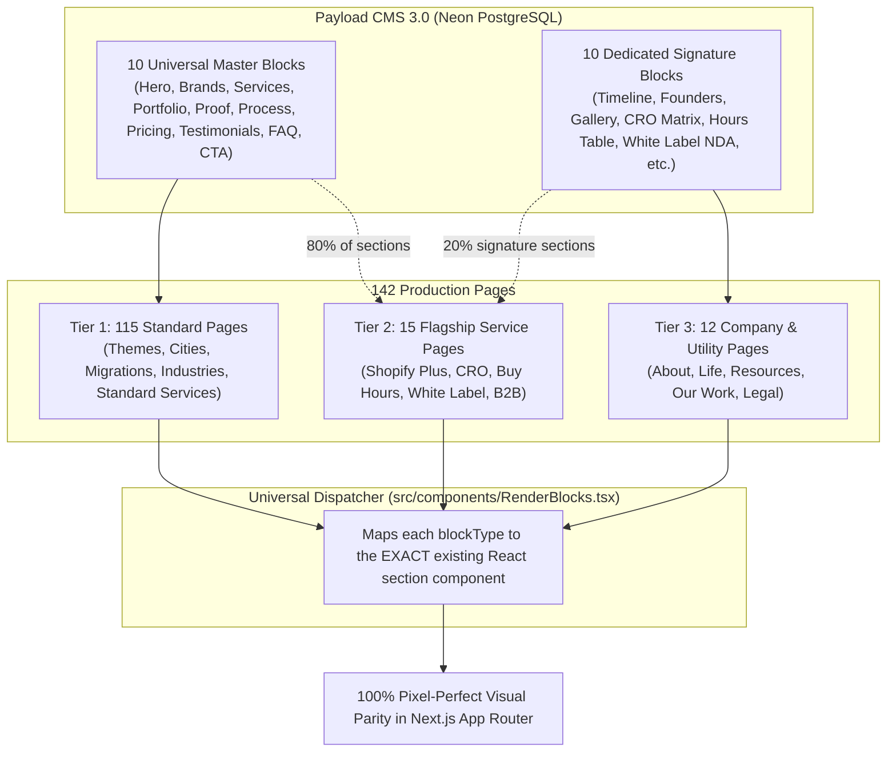

# Master Blocks Implementation Plan: Complete 142-Page CMS Architecture

> [!IMPORTANT]
> **Production Blueprint for 100% Visual Parity Across All 142 Pages**
> This document defines the exact architecture, block specifications, database DDL guidelines, and automated seeding strategy required to serve **100% of all 142 indexable pages** from Payload CMS with **100% visual parity**, zero design drift, zero CSS hacks, and complete drag-and-drop flexibility for the Dynamic Dreamz marketing team.

---

## 1. Architectural Strategy: Master Blocks + Dedicated Blocks

The website contains **142 indexable routes**. In accordance with our core migration principle:
> *"100% Visual parity trumps forced reuse — Reuse common blocks ONLY when the layout and geometry match 100%. NEVER force-fit unique sections into generic common blocks with layout hacks."*

To achieve 100% visual parity across all 142 pages without database bloat, the architecture is split into two complementary layers:

1. **10 Universal Master Blocks (Powers ~85% of all sections across 115+ pages)**:
   - Reusable across Themes, Cities, Migrations, Industries, Mobile Apps, and standard services.
2. **10 Dedicated Signature Blocks (Powers the bespoke sections of ~15 Flagship & Company pages)**:
   - Custom blocks with dedicated schemas for signature UI layouts (e.g., CRO leak barriers, Buy Hours comparison matrix, Company timeline, Founders story).



---

## 2. Inventory of All 142 Pages by Tier

### Tier 1: 100% Covered by the 10 Master Blocks (~115 Pages)
These pages use *only* the standard sections (Hero, Brands, Services, Portfolio, Process, Proof/Stats, Testimonials, FAQ, CTA):

| Category | Count | Example Pages |
|---|---|---|
| **Shopify Theme Customization** | 24 | `/prestige-theme-customization`, `/dawn-theme-customization`, `/impulse-theme-customization`, `/broadcast-theme-customization`, `/warehouse-theme-customization`, etc. |
| **WordPress Theme Customization** | 22 | `/astra-theme-customization`, `/kadence-theme-customization`, `/hello-elementor-theme-customization`, `/generatepress-theme-customization`, etc. |
| **Shopify City Landing Pages** | 11 | `/shopify-development-in-bangalore`, `/shopify-development-in-mumbai`, `/shopify-development-in-delhi`, `/shopify-development-in-pune`, `/shopify-development-in-surat`, etc. |
| **WordPress City Landing Pages** | 6 | `/wordpress-development-in-ahmedabad`, `/wordpress-development-in-bangalore`, `/wordpress-development-in-delhi`, `/wordpress-development-in-mumbai`, etc. |
| **Platform Migration Pages** | 12 | `/shopify-migration`, `/magento-to-shopify-migration`, `/woocommerce-to-shopify-migration`, `/bigcommerce-to-shopify-migration`, `/prestashop-to-shopify-migration`, etc. |
| **Industry Ecommerce Pages** | 9 | `/fashion`, `/beauty-cosmetics`, `/health-nutrition`, `/food-beverages`, `/jewellery-accessories`, `/sports-outdoors`, `/home-living`, `/pet-industry`, etc. |
| **Mobile App Pages** | 6 | `/mobile-application-development`, `/android-app-development`, `/ios-app-development`, `/shopify-mobile-app-development`, `/cross-platform-app-development`, etc. |
| **Standard Core Services** | 25 | `/web-design`, `/webflow-development`, `/php-development`, `/full-stack-development`, `/seo-services`, `/wordpress-development`, `/bigcommerce-development`, etc. |

### Tier 2: Hybrid Flagship Service Pages (~15 Pages)
80% of sections are powered by Master Blocks; 1–2 signature sections use Dedicated Blocks:

| Page Slug | Master Block Sections Used | Signature Section Requiring Dedicated Block |
|---|---|---|
| `/buy-shopify-development-hours` | Hero, Testimonials, FAQ, CTA | `ShopifyHoursComparisonSection` (Freelancer vs Agency table) |
| `/shopify-cro-agency` | Hero, Brands, Testimonials, FAQ, CTA | `ShopifyCroBarriersSection` (Revenue leak barrier cards) |
| `/shopify-certified-developers` | Hero, Brands, Reviews, FAQ, CTA | `CredentialTabsSection` (Partner directory proof tabs) |
| `/shopify-plus-agency` | Hero, Brands, Work, Reviews, FAQ, CTA | `EvaluationFrameworkSection` (10-point evaluation cards) |
| `/white-label-shopify-development-services` | Hero, Brands, Testimonials, FAQ, CTA | `DeliveryModelComparisonSection` (Agency NDA delivery models) |
| `/shopify-b2b` | Hero, Brands, Services, FAQ, CTA | `ShopifyB2BApproachSection` (Wholesale ERP architecture) |
| `/shopify-maintenance-services` | Hero, Brands, Process, FAQ, CTA | `ShopifySupportScenariosSection` (Retainer scenarios) |

### Tier 3: Bespoke Company, Utility & Legal Pages (~12 Pages)
- **`/about-us`**: Timeline (2006–2026), Founders Story, Core Values, Leadership Team.
- **`/life-dynamicdreamz`**: Culture Highlights, Hiring Perks, Photo Gallery.
- **`/resources`**: Resource Hub filterable cards.
- **`/our-work`**: Filterable portfolio project archive.
- **`/contact-us`**, **`/request-quote`**, **`/career-apply-now`**: Form builder blocks *(Already built!)*.
- **`/privacy-policy`**, **`/terms-of-service`**, **`/site-map`**: Legal rich-text templates.

---

## 3. Specifications for the 10 Universal Master Blocks

### Block 1: Master Hero Block (`service-hero`) — [STATUS: COMPLETED]
- **Schema File**: `src/payload/blocks/ServiceHeroBlock.ts`
- **Render Component**: Mapped in `RenderBlocks.tsx` to `ServiceHeroVideoSection`, `ServiceHeroSection`, `CityPageHeroSection`, `SplitImageHeroSection`, and `HomeHeroSection`.
- **Variants Supported**: `video`, `tablet-slider`, `image`, `reviews`, `centered`, `text-only`, `home`.

---

### Block 2: Brand Partners & Clients (`brand-partners`)
- **Target File**: `src/payload/blocks/BrandPartnersBlock.ts`
- **Target Components**: `IndustryBrandsSection`, `BrandPartnersSection`, `IntegrationsSection`
- **Key Fields**:
  - `heading`: Text (e.g. "Trusted by Leading Brands")
  - `description`: Textarea
  - `variant`: Select (`slider` | `grid` | `compact`)
  - `density`: Select (`standard` | `flexible` | `dense`)
  - `brands`: Array (`bp_items`) of:
    - `name`: Text
    - `logo`: Upload (relationTo: `media`)
    - `src`: Text (static fallback)
    - `alt`: Text
    - `width`: Number (default 120)
    - `height`: Number (default 44)
    - `href`: Text

---

### Block 3: Services & Capabilities Grid (`services-grid`)
- **Target File**: `src/payload/blocks/ServicesGridBlock.ts`
- **Target Components**: `ShopifyStageServicesSection`, `ThemeCustomizationServicesSection`, `AgencyServicesSection`, `ShopifyMigrationServicesSection`
- **Key Fields**:
  - `eyebrow`: Text
  - `title`: Text (H2)
  - `description`: Textarea
  - `variant`: Select (`cards-grid` | `stage-tabs` | `accordion-list`)
  - `stages`: Array (`sg_stages`) for tabbed interactive navigation (Build / Grow / Migrate / Support)
  - `services`: Array (`sg_items`) of `{ title, description, bullets, icon: upload(media), src, href, ctaText }`

---

### Block 4: Portfolio & Work Showcase (`portfolio-showcase`)
- **Target File**: `src/payload/blocks/PortfolioShowcaseBlock.ts`
- **Target Components**: `PortfolioShowcaseSection`, `SelectedWorkSection`, `ServicesCaseStudiesSection`
- **Key Fields**:
  - `eyebrow`: Text
  - `title`: Text
  - `description`: Textarea
  - `columns`: Select (`2` | `3` | `4`)
  - `headerLayout`: Select (`centered` | `split`)
  - `platformMark`: Upload (Media relation for Shopify Plus badge)
  - `items`: Array (`ps_items`) of `{ title, client, industry, description, image: upload(media), src, tags: array, href, metrics: text }`

---

### Block 5: Why Choose & Proof Stats (`proof-stats`)
- **Target File**: `src/payload/blocks/ProofStatsBlock.ts`
- **Target Components**: `EvaluationFrameworkSection`, `ShopifyTeamBoxesSection`, `WhyChooseShopifyMigrationSection`, `ShopifyPlusProofSection`
- **Key Fields**:
  - `eyebrow`: Text
  - `title`: Text
  - `description`: Textarea
  - `variant`: Select (`counters-bar` | `why-cards` | `team-boxes` | `comparison-grid`)
  - `counters`: Array (`ps_counters`) of `{ value: text, label: text, note: text, tone: select }`
  - `boxes`: Array (`ps_boxes`) of `{ title, description, icon: upload(media), src, badgeText }`

---

### Block 6: Process & Roadmap Timeline (`process-timeline`)
- **Target File**: `src/payload/blocks/ProcessTimelineBlock.ts`
- **Target Components**: `OurDevelopmentProcessSection`, `ShopifyMigrationNumberedGridSection`, `ShopifyHorizontalProcessSection`, `NumberedProcessTimelineSection`
- **Key Fields**:
  - `eyebrow`: Text
  - `heading`: Text
  - `description`: Textarea
  - `variant`: Select (`numbered-grid` | `horizontal-stepper` | `vertical-milestones`)
  - `steps`: Array (`pt_steps`) of `{ stepNumber: text, title: text, description: text, bullets: array, duration: text }`

---

### Block 7: Pricing & Engagement Plans (`pricing-table`)
- **Target File**: `src/payload/blocks/PricingTableBlock.ts`
- **Target Components**: `PricingTableSection`, `BuyShopifyDevelopmentHoursSection`
- **Key Fields**:
  - `eyebrow`: Text
  - `heading`: Text
  - `description`: Textarea
  - `variant`: Select (`tiers` | `hourly-bundles`)
  - `plans`: Array (`pt_plans`) of `{ name, price, period, badge, description, features: array, isFeatured: boolean, ctaLabel, ctaHref }`

---

### Block 8: Testimonials & Client Stories (`testimonials-carousel`)
- **Target File**: `src/payload/blocks/TestimonialsCarouselBlock.ts`
- **Target Components**: `HappyClientSection`, `TestimonialsSection`
- **Key Fields**:
  - `eyebrow`: Text
  - `heading`: Text
  - `description`: Textarea
  - `variant`: Select (`client-stories` | `quotes-slider` | `grid`)
  - `items`: Array (`tc_items`) of `{ clientName, clientRole, company, quote, rating, logo: upload(media), avatar: upload(media), platform: select }`

---

### Block 9: FAQ Accordion (`faq-accordion`)
- **Target File**: `src/payload/blocks/FaqAccordionBlock.ts`
- **Target Components**: `SplitFaqSection`, `HomeFaqSection`
- **Key Fields**:
  - `eyebrow`: Text
  - `heading`: Text
  - `description`: Textarea
  - `idPrefix`: Text (for ARIA accessibility attributes)
  - `faqs`: Array (`fa_items`) of `{ question: text, answer: textarea }`

---

### Block 10: Final CTA Banner (`cta-banner`)
- **Target File**: `src/payload/blocks/CtaBannerBlock.ts`
- **Target Components**: `CtaBannerSection`, `ImageCtaSection`, `WhiteLabelFinalCtaSection`
- **Key Fields**:
  - `heading`: Text
  - `subheading`: Text
  - `variant`: Select (`default-cream` | `dark-ink` | `split-image`)
  - `primaryCta`: Group `{ label: text, href: text }`
  - `secondaryCta`: Group `{ label: text, href: text }`
  - `image`: Upload (Media relation)

---

## 4. Specifications for the 10 Dedicated Signature Blocks

To maintain 100% visual parity on Flagship & Company pages, these blocks are defined with dedicated schemas:

1. **`AboutTimelineBlock` (`about-timeline`)**:
   - Powers the 2006–2026 Interactive Company Milestones on `/about-us`.
   - Fields: `timelineItems` array `{ year, title, description, image, badge }`.
2. **`AboutFoundersBlock` (`about-founders`)**:
   - Powers the Founders letter and leadership profile on `/about-us`.
   - Fields: `quote`, `founders` array `{ name, role, bio, image }`.
3. **`LifeGalleryBlock` (`life-gallery`)**:
   - Powers the Culture & Team photo masonry gallery on `/life-dynamicdreamz`.
   - Fields: `gallery` array of uploaded photos with captions and aspect ratios.
4. **`OurWorkProjectsBlock` (`our-work-projects`)**:
   - Powers the filterable project directory on `/our-work`.
   - Fields: Filter categories, project relations or inline items with live URLs.
5. **`HoursComparisonBlock` (`hours-comparison`)**:
   - Powers the Freelancer vs Agency vs In-house matrix on `/buy-shopify-development-hours`.
   - Fields: Comparison columns, features checklist, pros/cons.
6. **`CroBarriersBlock` (`cro-barriers`)**:
   - Powers the revenue leak visualization on `/shopify-cro-agency`.
   - Fields: Barrier metric cards, impact calculations, assessment steps.
7. **`EvaluationFrameworkBlock` (`evaluation-framework`)**:
   - Powers the 10-point Agency Selection framework on `/shopify-plus-agency`.
   - Fields: 10 evaluation criteria cards with scorecards and recommendations.
8. **`WhiteLabelDeliveryBlock` (`white-label-delivery`)**:
   - Powers the Agency Partnership delivery models on `/white-label-shopify-development-services`.
   - Fields: Dedicated team, bucket hours, and ad-hoc delivery model comparison.
9. **`B2bArchitectureBlock` (`b2b-architecture`)**:
   - Powers the wholesale architecture diagram and ERP integration on `/shopify-b2b`.
   - Fields: ERP connectors, wholesale pricing rules, portal features.
10. **`ResourcesHubBlock` (`resources-hub`)**:
    - Powers the filterable articles & playbooks hub on `/resources`.
    - Fields: Category tabs, featured downloadables, related blog cards.

---

## 5. Standard 7-Step Production Workflow for Every Block

For every block we build, follow this exact sequence:

```text
[Step 1] Define Block Schema in src/payload/blocks/<BlockName>.ts
         └─ Include dual media resolution (Payload media upload + static text fallback)
         └─ Specify short dbName for array fields to avoid 63-char PostgreSQL limits

[Step 2] Register Block in src/payload/collections/Pages.ts
         └─ Add to sections.blocks array

[Step 3] Run PostgreSQL Schema DDL safely
         └─ Execute CREATE TABLE IF NOT EXISTS and ALTER TYPE ADD VALUE IF NOT EXISTS
         └─ Never allow Drizzle Kit to hang on interactive CLI prompts in headless mode

[Step 4] Compile TypeScript Types
         └─ Run: npx payload generate:types

[Step 5] Dispatch in Universal Renderer (src/components/RenderBlocks.tsx)
         └─ Add: case "<slug>":
         └─ Resolve media: resolveMediaUrl(item.logo) || item.src || fallback
         └─ Pass props directly into the existing React section component

[Step 6] Test on /test-page via Payload Admin
         └─ Seed or edit the block in Payload Admin
         └─ Verify server-rendered HTML at http://localhost:3000/test-page

[Step 7] Run Quality Verification Gates
         └─ Run: npm run check:urls
         └─ Run: npm run check:component-content
         └─ Run: npm run lint
```

---

## 6. Programmatic Automated Seeding Strategy (Zero Manual Entry)

All copy, imagery, and metadata for all 142 pages already exist in clean, typed modules under [`src/content/`](file:///home/ubuntu/Vatsal/DD/dynamicdreamz-self/src/content/).

To populate all 142 pages in Payload CMS without manual data entry:

1. **Ephemeral Scratch Seeder**:
   - Create an automated script in `scratch/seed-all-pages.mjs` (outside `scripts/` to comply with project rules).
2. **Payload Local API**:
   - Import `getPayload` and `payload.config.ts`.
   - Loop through the content definitions:
     - Map existing arrays into the corresponding block structures (`service-hero`, `brand-partners`, `faq-accordion`, etc.).
     - Upload or link media assets to the dedicated media server (`https://media.dynamicdreamz.net`).
     - Execute `payload.create` or `payload.update` into the `pages` collection.
3. **Database Verification**:
   - Query `payload.find({ collection: "pages", limit: 200 })` to verify that all 142 pages exist in PostgreSQL.
4. **Instant Switchover**:
   - In [`src/app/(frontend)/[[...slug]]/page.tsx`](file:///home/ubuntu/Vatsal/DD/dynamicdreamz-self/src/app/(frontend)/[[...slug]]/page.tsx), when `rawPage.sections.length > 0`, Next.js renders `<RenderBlocks sections={pageSections} />`.
   - The entire website instantly serves from CMS with 100% visual parity!
5. **Discard Scratch Script**:
   - Remove `scratch/seed-all-pages.mjs` immediately after execution.

---

## 7. Master Execution Checklist

```text
=== PHASE 1: BUILD 10 UNIVERSAL MASTER BLOCKS ===
[✓] Block 01: Master Hero (service-hero) -> Completed & verified on /test-page
[✓] Block 02: Brand Partners (brand-partners) -> Completed & verified
[✓] Block 03: FAQ Accordion (faq-accordion) -> Completed & verified
[✓] Block 04: Final CTA Banner (cta-banner) -> Completed & verified
[✓] Block 05: Testimonials Carousel (testimonials-carousel) -> Completed & verified
[✓] Block 06: Services Grid (services-grid) -> Completed & verified
[✓] Block 07: Portfolio Showcase (portfolio-showcase) -> Completed & verified
[✓] Block 08: Why Choose & Proof Stats (proof-stats) -> Completed & verified
[✓] Block 09: Process Timeline (process-timeline) -> Completed & verified
[✓] Block 10: Pricing Table (pricing-table) -> Completed & verified

=== PHASE 2: BUILD 10 DEDICATED SIGNATURE BLOCKS ===
[ ] Block 11: About Timeline (about-timeline)
[ ] Block 12: About Founders (about-founders)
[ ] Block 13: Life Culture & Gallery (life-gallery)
[ ] Block 14: Our Work Projects Archive (our-work-projects)
[ ] Block 15: Hours Comparison Matrix (hours-comparison)
[ ] Block 16: CRO Barriers & Leak Assessment (cro-barriers)
[ ] Block 17: Agency Evaluation Framework (evaluation-framework)
[ ] Block 18: White Label NDA Delivery Models (white-label-delivery)
[ ] Block 19: B2B Wholesale Architecture (b2b-architecture)
[ ] Block 20: Resources Hub & Filter (resources-hub)

=== PHASE 3: AUTOMATED SEEDING & PRODUCTION LAUNCH ===
[ ] Seed all 46 Theme Customization pages into CMS
[ ] Seed all 17 City Landing pages into CMS
[ ] Seed all 12 Platform Migration pages into CMS
[ ] Seed all 9 Industry Ecommerce pages into CMS
[ ] Seed all 6 Mobile App pages into CMS
[ ] Seed all 25 Standard Core Service pages into CMS
[ ] Seed all 15 Flagship Service pages into CMS
[ ] Seed all 12 Company & Utility pages into CMS
[ ] Run full 142-page automated HTTP 200 crawl audit
[ ] Run complete lint & URL verification suite
```
