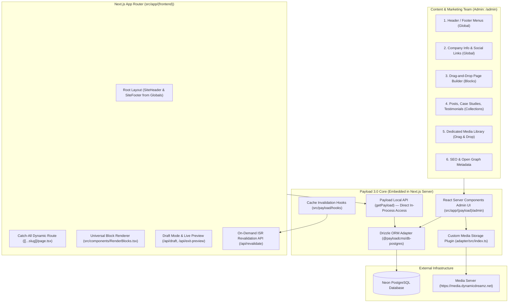
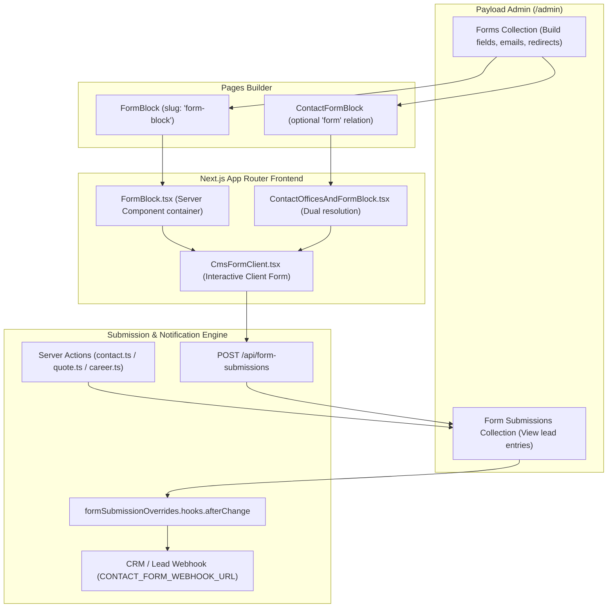

# Dynamic Dreamz Payload CMS 3.0 Technical Architecture & Developer Reference

> [!IMPORTANT]
> **PAYLOAD CMS 3.0 IS FULLY INTEGRATED & RUNNING IN PRODUCTION**
> Payload CMS 3.0 is embedded natively within the Next.js App Router, powered by PostgreSQL on Neon and Dynamic Dreamz's dedicated high-performance media server (`https://media.dynamicdreamz.net`). All globals, collections, blocks, frontend routes, preview endpoints, and cache revalidation hooks are 100% implemented, operational, and live.
> 
> **DO NOT** attempt to scaffold, re-install, or "re-implement" Payload CMS. This document serves as the **authoritative technical architecture and developer maintenance guide** for maintaining, seeding, or extending the CMS.

---

## 1. Architectural Overview: Next.js Native Payload 3.0

Unlike legacy headless setups (such as Strapi or standalone CMS containers) that run as separate external processes requiring network hops, ports, and REST/GraphQL HTTP overhead, **Payload 3.0 runs directly inside the Next.js App Router runtime**:



### Key Technical Advantages
1. **Single Runtime & Deployment**: Zero external microservices or standalone backend servers to manage. Deploying Next.js simultaneously deploys the frontend and the CMS backend.
2. **Zero HTTP Latency**: Next.js Server Components query database records directly in-process via `getPayload({ config })` using Drizzle ORM without network latency, serialization delays, or bearer token overhead.
3. **End-to-End TypeScript Types**: Types are auto-generated from collection definitions directly into `src/types/payload-types.ts` via `npm run payload generate:types`.
4. **App Router Route Group Isolation**:
   - `src/app/(frontend)/`: Public marketing routes, layouts, Tailwind styles, and fonts.
   - `src/app/(payload)/`: Isolated Payload Admin Panel (`/admin`) and internal REST/GraphQL endpoints.

---

## 2. Master Repository Structure & File Map

The Payload CMS implementation is organized cleanly in the codebase under `src/payload/`:

```text
dynamicdreamz-self/
├── adapter/                               # Dedicated Media Server Storage Plugin
│   ├── package.json                       # Adapter package configuration
│   └── src/index.ts                       # Cloud storage adapter for https://media.dynamicdreamz.net
├── payload.config.ts                      # Master Payload 3.0 configuration
├── src/
│   ├── app/
│   │   ├── (frontend)/                    # Public website App Router group
│   │   │   ├── layout.tsx                 # Root layout (fetches Navigation & SiteSettings)
│   │   │   ├── [[...slug]]/page.tsx       # Dynamic catch-all route (homepage & all pages)
│   │   │   ├── blogs/                     # Blog archive & [slug] article routes
│   │   │   ├── case-studies/              # Case studies archive & [slug] routes
│   │   │   └── api/                       # Preview & cache revalidation handlers
│   │   │       ├── draft/route.ts         # Enables Next.js Draft Mode for CMS Live Preview
│   │   │       ├── exit-preview/route.ts  # Exits Draft Mode
│   │   │       └── revalidate/route.ts    # On-demand ISR purge endpoint
│   │   └── (payload)/                     # CMS App Router group
│   │       ├── admin/[[...segments]]/     # Payload Admin panel React Server Component UI
│   │       ├── api/[...slug]/             # Payload REST API endpoints
│   │       ├── api/graphql/               # Payload GraphQL endpoint
│   │       └── layout.tsx                 # Payload Admin layout and theme isolation
│   ├── components/
│   │   ├── RenderBlocks.tsx               # Universal React dispatcher mapping blockTypes to UI
│   │   └── blocks/                        # Concrete React section components (styled & responsive)
│   ├── lib/
│   │   ├── payload.ts                     # Typed Local API fetch helper functions & fallbacks
│   │   └── service-pages-registry.tsx     # Static coded fallbacks for unseeded pages
│   ├── payload/                           # Master Payload CMS definition directory
│   │   ├── blocks/                        # 50+ modular block schemas (TypeScript)
│   │   │   ├── blog/                      # Discrete rich editorial blocks (headings, quotes, tables)
│   │   │   ├── HeroBlock.ts
│   │   │   ├── BrandPartnersBlock.ts
│   │   │   ├── FaqAccordionBlock.ts
│   │   │   ├── FeaturesGridBlock.ts
│   │   │   ├── ProofCountersBlock.ts
│   │   │   └── ... (all unique section block schemas)
│   │   ├── collections/                   # Content collections
│   │   │   ├── Users.ts                   # Admin and editor authentication
│   │   │   ├── Media.ts                   # Uploaded images, SVG icons, and videos
│   │   │   ├── Categories.ts              # Blog taxonomies
│   │   │   ├── Authors.ts                 # Editorial team profiles
│   │   │   ├── Testimonials.ts            # Client reviews and quotes
│   │   │   ├── Posts.ts                   # Blog posts with structured blocks
│   │   │   ├── CaseStudies.ts             # Portfolio case studies with metrics
│   │   │   └── Pages.ts                   # Dynamic pages with 'sections' blocks field
│   │   ├── globals/                       # Site-wide settings
│   │   │   ├── Navigation.ts              # Header menus, footer columns, and bottom links
│   │   │   └── SiteSettings.ts            # Company info, phone, WhatsApp, addresses
│   │   └── hooks/
│   │       └── revalidatePage.ts          # Automated cache invalidation hook
│   └── types/
│       ├── payload-types.ts               # Auto-generated Payload types (DO NOT edit manually)
│       └── blocks.ts                      # Frontend block union types
```

---

## 3. Dedicated Media Server Integration (`https://media.dynamicdreamz.net`)

All media uploaded through Payload CMS is automatically offloaded to Dynamic Dreamz's dedicated high-performance media server. No static uploads bloat the Git repository or local disk.

### 1. Adapter Mechanics (`adapter/src/index.ts`)
- **Plugin**: Implemented via `@payloadcms/plugin-cloud-storage` using a custom HTTP upload/delete adapter.
- **Base URL**: `https://media.dynamicdreamz.net` (configured via `MEDIA_SERVER_URL` environment variable).
- **Security**: Authenticated with `MEDIA_SERVER_API_KEY` passed via the `x-api-key` header.
- **Storage Prefix**: `uploads`.
- **Public URL Format**: `https://media.dynamicdreamz.net/files/uploads/<filename>`.
- **Upload Endpoint**: `PUT https://media.dynamicdreamz.net/api/objects/uploads/<filename>`.
- **Delete Endpoint**: `DELETE https://media.dynamicdreamz.net/api/objects/uploads/<filename>`.

### 2. Resilient Fallback Pattern in Code
- **Build/CI Safety**: If `MEDIA_SERVER_URL` or `MEDIA_SERVER_API_KEY` are unset (e.g. during CI builds or local scratch scripts), the adapter gracefully falls back to local storage rather than halting the build.
- **IPv4-First DNS**: Node.js 18+ can hang on environments without full IPv6 egress routing. The adapter invokes `dns.setDefaultResultOrder('ipv4first')` to ensure instantaneous connection.
- **Dual-Resolution in UI Components**: Every React component and block renderer supports dual resolution:
  ```ts
  // Example dual-resolution pattern
  const imageUrl = (typeof block.image === "object" && block.image?.url)
    ? block.image.url
    : (fallbackLocalPath || "/assets/placeholder.webp");
  const imageAlt = (typeof block.image === "object" && block.image?.alt)
    ? block.image.alt
    : (fallbackAlt || "");
  ```
- **Admin `_objectKey` Column**: `@payloadcms/plugin-cloud-storage` generates an internal `_objectKey` column. In this server adapter, file paths are deterministic (`prefix + filename`), so `_objectKey` is intentionally null. Editors can hide this column via the **Columns** dropdown in Payload Admin.

---

## 4. Frontend Data Layer & Fetch Patterns (`src/lib/payload.ts`)

Data retrieval is handled server-side in Server Components using typed helper functions.

### 1. Zero-HTTP In-Process Querying
All functions import `getPayload({ config })` from `payload` directly:
```ts
import { getPayload } from "payload";
import config from "@payload-config";

export async function getPayloadPageBySlug(slug: string, options?: { preview?: boolean }) {
  try {
    const payload = await getPayload({ config });
    const result = await payload.find({
      collection: "pages",
      where: { slug: { equals: slug } },
      draft: options?.preview ?? false,
      depth: 2,
      limit: 1,
    });
    return result.docs[0] || null;
  } catch (err) {
    console.warn(`Failed to fetch page '${slug}' from Payload:`, err);
    return null;
  }
}
```

### 2. Hybrid Fallback Strategy
To guarantee 100% uptime and zero broken routes during migration:
- If a page, blog, or navigation is populated in Payload CMS, the site renders the CMS content.
- If a route has not yet been seeded into Payload or the database is temporarily unreachable, the frontend automatically falls back to the static baseline code (`src/lib/service-pages-registry.tsx`, `src/data/navigation.ts`, `src/content/blogs.ts`).

---

## 5. Dynamic Routing & Presentation Boundary

### 1. Universal Dynamic Route (`src/app/(frontend)/[[...slug]]/page.tsx`)
The optional catch-all route handles both the homepage (`/`) and all nested pages:
1. Resolves `pageSlug` from URL parameters.
2. Checks for Next.js Draft Mode (`draftMode().isEnabled`).
3. Queries Payload CMS via `getPayloadPageBySlug(pageSlug, { preview })`.
4. If `page.sections` contains populated blocks, renders them via `<RenderBlocks blocks={page.sections} />`.
5. If unseeded in Payload, falls back to the static registry entry in `service-pages-registry.tsx`.

### 2. The Strict Presentation Boundary
Payload CMS is the **content authority**; React is the **presentation authority**:
- **Payload CMS**: Stores editable copy, numbers, links, media relations, and defines the block sequence.
- **React (`src/components/RenderBlocks.tsx`)**: Controls 100% of HTML semantics, Tailwind classes, responsive layouts, hover states, and animations.
- **NO Rich Text HTML Injections**: Blocks use discrete scalar fields (strings, numbers, upload relations). No unstructured rich text dumps.

---

## 6. Content Collections & Globals

### Collections (`src/payload/collections/`)
| Collection | Slug | Purpose |
| :--- | :--- | :--- |
| **Pages** | `pages` | Dynamic marketing, landing, and service pages. Uses the `sections` blocks field with all 50+ modular blocks. Includes SEO metadata fields and Draft Mode live preview. |
| **Posts** | `posts` | Editorial blog articles assembled with structured blog blocks (`blog-heading`, `blog-paragraph`, `blog-image`, `blog-list`, `blog-table`, `blog-quote`, `blog-callout`, `blog-divider`). |
| **Case Studies** | `case-studies` | Client success stories with metrics, challenges, solutions, deliverables, and gallery images. |
| **Testimonials** | `testimonials` | Client reviews, star ratings, reviewer roles, company logos, and video review links. |
| **Media** | `media` | Uploaded assets stored on `https://media.dynamicdreamz.net`. Automatically tracks alt text and dimensions. |
| **Categories** | `categories` | Blog taxonomy categories. |
| **Authors** | `authors` | Blog post authors with avatars and bios. |
| **Users** | `users` | Admin and editor accounts with authentication. |
| **Forms** | `forms` | Dynamic custom forms powered by `@payloadcms/plugin-form-builder`. Configured with modular field blocks, on-screen Lexical confirmation or internal page redirect, and templated notification emails. |
| **Form Submissions** | `form-submissions` | Captured form entries and inquiries across all forms with field/value arrays, timestamps, and automated forwarding to webhook. |

### Globals (`src/payload/globals/`)
| Global | Slug | Purpose |
| :--- | :--- | :--- |
| **Navigation** | `navigation` | Site-wide header dropdown menus, footer columns, and bottom legal links. |
| **Site Settings** | `site-settings` | Global company info (phone numbers, WhatsApp digits, contact emails, Skype, office addresses, social links). |

---

## 7. Draft Mode, Live Preview & Cache Invalidation

### 1. Live Preview & Draft Mode
- When an editor clicks **"Live Preview"** in Payload Admin, an iframe opens pointing to `/api/draft?secret=...&slug=...`.
- Next.js enables draft mode (`draftMode().enable()`), allowing unpublished draft documents to be rendered in real-time.
- To exit draft mode, the user visits `/api/exit-preview`.

### 2. On-Demand ISR Cache Revalidation
- When a document is published, updated, or deleted, the `revalidatePage` hook (`src/payload/hooks/revalidatePage.ts`) triggers on-demand revalidation.
- Calls `revalidatePath("/" + slug)` and purges the Next.js cache tag, ensuring instant public updates without site rebuilds.

---

## 8. Form Builder Plugin & Universal Form Handling (`@payloadcms/plugin-form-builder`)

All dynamic and standard form handling is powered natively by `@payloadcms/plugin-form-builder` combined with our frontend React architecture:



### 1. Configuration in `payload.config.ts`
The plugin is configured with:
- `fields`: Built-in fields enabled (`text`, `email`, `textarea`, `select`, `number`, `checkbox`, `country`, `state`, `message`). Payment fields are disabled.
- `redirectRelationships: ['pages']`: Allows selecting internal pages as redirect targets upon submission.
- `formSubmissionOverrides.hooks.afterChange`: Automatically forwards submissions to `CONTACT_FORM_WEBHOOK_URL` with bearer token authentication if configured.
- `access`: `create: () => true` allows public frontend visitors to submit inquiries; `read` is restricted to authenticated admin users.

### 2. Form Placement on Dynamic Pages
1. **Generic `FormBlock` (`src/payload/blocks/FormBlock.ts`)**:
   - Slug: `form-block`
   - Editors can drop a form anywhere on any page via the `sections` field in `Pages`.
   - Fields: `form` (relationship to `forms`), `enableIntro`, `introContent`, `eyebrow`, `title`, `description`, `containerWidth`.
2. **`ContactFormBlock` (`src/payload/blocks/ContactFormBlock.ts`)**:
   - Includes an optional `form` relationship field. If an editor selects a custom Form, the contact section renders the dynamic form. If left empty, it falls back to the default contact form.

### 3. Frontend Component Architecture (`src/components/forms/CmsFormClient.tsx`)
- Server-rendered container with client-interactive form boundary (`CmsFormClient`).
- Supports half-width (2-column desktop) and full-width inputs matching the Dynamic Dreamz design system.
- Built-in anti-spam honeypot (`name="website"`).
- UTM attribution capture (`utm_source`, `utm_medium`, `utm_campaign`, etc.).
- Lexical rich-text confirmation message or page redirect handling.
- Fully typed display strings from `src/content/forms.ts` (`cmsFormCopy`).

### 4. Dual-Recording in Server Actions
The standard server actions (`submitContactForm` in `contact.ts` and `submitQuoteForm` in `quote.ts`) record incoming inquiries directly into Payload's `form-submissions` collection while maintaining external webhook forwarding.

---

## 9. How to Add or Extend a Block (Developer Guide)

When a new page design requires a section that does not match any existing block:

### Step 1: Define the Block Schema in Payload
Create a new block config in `src/payload/blocks/MyNewBlock.ts`:
```ts
import type { Block } from "payload";

export const MyNewBlock: Block = {
  slug: "my-new-block",
  labels: {
    singular: "My New Section",
    plural: "My New Sections",
  },
  fields: [
    { name: "title", type: "text", required: true },
    { name: "subtitle", type: "text" },
    { name: "image", type: "upload", relationTo: "media" },
    // Add other scalar fields as needed
  ],
};
```

### Step 2: Register the Block in `Pages.ts`
Import and add `MyNewBlock` to the `blocks` array in `src/payload/collections/Pages.ts`:
```ts
import { MyNewBlock } from "../blocks/MyNewBlock";

// Inside Pages collection sections field:
blocks: [
  // ...existing blocks
  MyNewBlock,
]
```

### Step 3: Create the React Component
Create `src/components/blocks/MyNewBlock.tsx`:
```tsx
import React from "react";
import Image from "next/image";

interface MyNewBlockProps {
  title?: string;
  subtitle?: string;
  image?: { url?: string; alt?: string } | null;
}

export const MyNewBlock: React.FC<MyNewBlockProps> = ({ title, subtitle, image }) => {
  return (
    <section className="py-20 bg-white">
      <div className="container mx-auto px-4">
        <h2>{title}</h2>
        {subtitle && <p>{subtitle}</p>}
        {image?.url && (
          <Image src={image.url} alt={image.alt || ""} width={600} height={400} />
        )}
      </div>
    </section>
  );
};
```

### Step 4: Register the Component in `RenderBlocks.tsx`
Add the mapping to `src/components/RenderBlocks.tsx`:
```tsx
import { MyNewBlock } from "./blocks/MyNewBlock";

// Inside the block switch/map:
case "my-new-block":
  return <MyNewBlock key={index} {...block} />;
```

### Step 5: Regenerate Types & Verify
```bash
npm run check:urls
npm run check:component-content
npx tsc --noEmit
npm run lint
```

---

## 10. Non-Technical Operations Runbook

For non-technical team members, editors, and clients managing pages, menus, or blog posts via the Admin Panel:
> Refer to the dedicated guide: **[`docs/wordpress-team-operations-runbook.md`](wordpress-team-operations-runbook.md)**.

---

## 11. Quality Verification Suite

Always verify changes with the production quality gate commands:

```bash
# 1. URL policy audit (enforces trailing-slash-free URLs)
npm run check:urls

# 2. Enforce component copy separation
npm run check:component-content

# 3. TypeScript type validation
npx tsc --noEmit

# 4. ESLint verification
npm run lint

# 5. Production build test
npm run build
```
